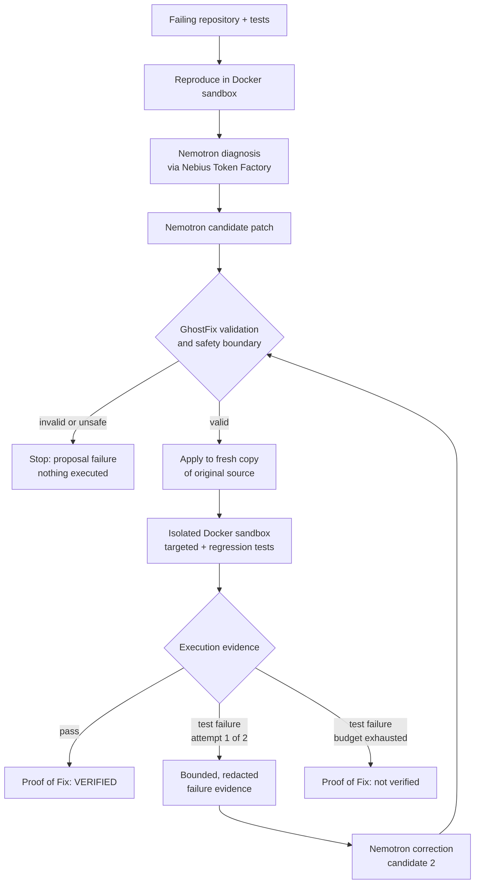

# GhostFix AI

**Find the bug. Fix the bug. Prove the fix.**

GhostFix AI is an autonomous software-repair agent. It reproduces a failure,
diagnoses the likely root cause, proposes a constrained patch, executes that
candidate inside an isolated Docker sandbox, verifies targeted and regression
tests, and produces a deterministic Proof of Fix.

Most coding assistants stop after generating code. GhostFix treats generated
code as an **untrusted candidate** until execution evidence verifies it.

**Live demo: https://ghostfix-ai.onrender.com/**

> The public demo is a **recorded evidence replay** of one real repair run.
> Opening it makes no model calls and no Docker calls; it renders evidence that
> was captured from actual execution. If the instance is idle, the first load
> may take a moment.

Built for the **Nebius × NVIDIA Global AI Hackathon 2026**, track **Coding and
Agentic Engineering**.

---

## Core principle

> **Don't just generate a fix. Prove it works.**

```text
LLM reasons  →  GhostFix tools act  →  sandbox executes  →  evidence decides
```

A model can be confidently wrong, so GhostFix never asks the model whether its
patch works. The model proposes. Deterministic code validates the proposal,
applies it to a disposable copy of the repository, and runs the tests in an
isolated container. Only the executed result decides whether a repair is
VERIFIED.

## How it works

| Step | What happens | Decided by |
|---|---|---|
| 1. Reproduce | Run the repository's tests in the sandbox; a real failure (pytest exit 1) is required to continue | Execution |
| 2. Diagnose | Structured root-cause hypothesis from the failure evidence and bounded source context | Model (hypothesis only) |
| 3. Propose | Constrained candidate patch (unified diff) with selected tests | Model |
| 4. Validate | Strict patch subset matched against the original source, plus path, size and security policy | GhostFix |
| 5. Execute | Apply to a fresh temporary copy of the **original** source; run in an isolated Docker container | GhostFix + sandbox |
| 6. Verify | Targeted tests, then the full regression suite | Execution |
| 7. Self-correct | Only after an eligible execution failure: one bounded, evidence-driven correction | Model, gated by GhostFix |
| 8. Prove | Deterministic Proof of Fix built from the recorded run | GhostFix |

Model confidence never determines the outcome. A candidate is **VERIFIED** only
if it was applied, its targeted and regression tests passed, the original
source was unchanged and the temporary workspace was cleaned up.

## Architecture



**LLM reasons. GhostFix tools act. Sandbox executes. Evidence decides.**

## Autonomous self-correction

Self-correction is bounded and evidence-driven:

- **Diagnosis happens once.** It is not rerun between attempts.
- **At most two candidates** by default (`RepairLoop`, `max_attempts=2`).
- **A retry happens only** after a valid candidate was safely applied and its
  targeted or regression tests failed with a genuine test failure (pytest exit
  code 1).
- **The correction request carries bounded, redacted evidence:** the failed
  patch, the verification status, the exit code, up to 10 failed test IDs and
  at most 2,000 characters of output per stream. The whole request is capped
  at 60,000 bytes, and host paths and known credentials are removed.
- **Attempt 2 starts from the original approved source** in a new temporary
  workspace. It is never layered on top of attempt 1.
- **These end the run instead of triggering a speculative retry:** invalid or
  unsafe proposals, patch-application failures, infrastructure failures,
  timeouts, source-integrity failures and cleanup failures.

This keeps the loop finite and auditable. Every extra model call has to be
justified by recorded execution evidence, never by a guess that "another try
might work".

Model protocol settings: temperature 0, thinking disabled, structured JSON
output, no SDK retries. The only protocol retries are one narrow,
evidence-gated retry for an over-long diagnosis and one for a provably
recoverable patch-format defect. GhostFix also deterministically repairs a few
diff **representation** defects when the original source proves the fix, such
as a missing context-line prefix, a missing final newline or wrong hunk counts.
It never repairs patch **semantics**.

## Canonical demo: recorded self-correction

The live demo replays run `aa6b79d21b954663b378a40f610d3334` on a small
calculator bug (`add` returns `left - right`).

| Stage | What happened | Source |
|---|---|---|
| Reproduction | `test_calculator.py::test_adds_two_numbers` failed in Docker (exit 1) | Executed evidence |
| Diagnosis | "Function body implements subtraction operator (-) rather than addition operator (+)." | Model hypothesis (Nemotron) |
| **Attempt 1** | **Deliberately demo-injected** patch: `return left * right`. Safe, syntactically valid and intentionally wrong. It was **not** generated by Nemotron. | Demo injection |
| Attempt 1 verification | Executed in the real Docker sandbox. The targeted test **failed**: `assert 6 == 5` | Executed evidence |
| Correction | That captured pytest evidence was supplied to the correction request | Recorded request |
| **Attempt 2** | **Generated by Nemotron**: `return left + right`, applied to a fresh copy of the original source | Model |
| Attempt 2 verification | Targeted tests **4/4 passed**, regression tests **4/4 passed** | Executed evidence |
| Proof of Fix | **VERIFIED**. Original source unchanged, workspaces cleaned | Deterministic report |

The first candidate was injected because a correct model usually fixes this
bug on the first try, which would not exercise self-correction. Injection lives
only in a demo script (`scripts/test_self_correction.py`); production code and
the benchmark runner have no injection option, and tests enforce this. The
record shows that the failure evidence was *supplied* to the correction step.
It cannot show how the model used it internally.

## Proof of Fix

Proof of Fix (`app/reporting/proof.py`) is a deterministic projection of the
recorded repair run. It is not another LLM opinion. It reports:

- **Reproduction:** the original failing tests and exit code.
- **Root cause**, labelled **MODEL HYPOTHESIS**.
- **Repair trajectory:** every attempt, with its candidate patch and provenance.
- **Targeted and regression verification:** pytest results from the sandbox.
- **Integrity:** whether the original source was unchanged and the workspace cleaned.
- **Final status:** `VERIFIED`, `VERIFICATION_FAILED`, `NOT_VERIFIED` or
  `INCOMPLETE_EVIDENCE`.

| | |
|---|---|
| **MODEL HYPOTHESIS** | What the model believes is wrong |
| **EXECUTED EVIDENCE** | What the sandbox actually observed |

Evidence decides. Contradictory flags or missing evidence can never produce
`VERIFIED`.

## Nebius + NVIDIA integration

The runtime reasoning model is **`nvidia/Nemotron-3_5-Lightning`**, accessed
through **Nebius Token Factory** using an OpenAI-compatible client
(`app/llm/nebius_client.py`).

**What the model does:**
- produces a structured root-cause diagnosis;
- proposes a constrained repair (a unified diff plus the tests to run);
- produces an evidence-grounded correction after a verified failure.

**What the model does not decide:**
- whether the tests actually passed;
- whether a patch is safe to execute;
- whether the original repository stayed unchanged;
- whether the Proof of Fix is VERIFIED.

Those decisions come from deterministic GhostFix code and execution evidence.

## Security and execution isolation

Candidate code runs only in a container started with these flags
(`app/sandbox/runner.py`):

| Control | Setting |
|---|---|
| Network | `--network=none` |
| Root filesystem | `--read-only` |
| Repository mount | bind mount `readonly`, `bind-recursive=disabled` |
| User | unprivileged `--user=10001:10001` |
| Capabilities | `--cap-drop=ALL`, `--security-opt=no-new-privileges:true` |
| Resources | `--cpus=1`, `--memory=512m`, `--memory-swap=512m`, `--pids-limit=128` |
| Scratch space | `--tmpfs=/tmp` with `noexec,nosuid,nodev`, 64 MB |
| Image | `--pull=never` (local image only) |
| Lifetime | `--rm`; on timeout (default 120 s) the container is force-removed |

Around the sandbox:

- **Patch policy** (`app/agent/patches.py`): only existing, supplied, ordinary
  `.py` files may change.
  - Rejected: test modification, path traversal, hidden, sensitive, dependency
    or configuration paths, file creation, deletion, renames and binary content.
  - Limits: 2 files, 100 changed lines and 12,000 diff bytes.
- **Fresh temporary workspace** per attempt. It is verified to be deleted
  afterwards, and the original repository is byte-compared before and after.
- **Repository code is never imported or executed on the host.**
- **Secrets:** known credentials and common secret patterns are redacted from
  model inputs and recorded evidence.
- **Response provenance:** each raw model response is recorded with its
  SHA-256. The audit tooling stores safe raw text verbatim, and withholds unsafe
  text while keeping its hash and the reason.

## Benchmark evidence

A frozen 7-case Python corpus (2 easy, 3 medium, 2 harder) measured three
versions of the model-to-patch protocol:

| Version | Verified repairs | Invalid proposals | Reached Docker verification |
|---|---|---|---|
| v1 | 1/7 — 14.29% | 5 (+1 diagnosis failure) | 1 |
| v2 | 3/7 — 42.86% | 4 | 3 |
| v3 | 4/7 — 57.14% | 3 | 4 |

In v3:
- 7 diagnosis calls and 7 proposal calls, with no benchmark retries;
- deterministic recovery was attempted on 4 malformed proposals and succeeded once;
- all 4 executable candidates passed both targeted and regression tests.

The 3 remaining v3 failures were all invalid unified diffs, rejected before
execution:
- hunk counts that contradicted the body;
- a changed line written as unchanged context;
- an unproven trailing line.

**Caveats:**
- This is a small corpus with one official run per version, and model output
  is stochastic. These are engineering measurements, not statistical proof.
- They do not mean GhostFix succeeds on 57% of bugs in general.
- The canonical self-correction demo is **not** counted in these results.
- Corpus definition: `benchmarks/manifest.json` and `fixtures/`, documented in
  [docs/benchmark-corpus.md](docs/benchmark-corpus.md). Raw run evidence is
  generated locally under the gitignored `artifacts/` directory and is not
  published in this repository.

## Known limitation: model-to-patch serialization

In a separate one-shot experiment on a **fresh project outside the benchmark
corpus** (a loyalty-discount function):

- GhostFix reproduced the failure.
- Nemotron correctly diagnosed the boundary bug: `loyalty_years > 5` should be
  `loyalty_years >= 5`.
- The model's intended change was the correct one, but the unified diff it
  generated was malformed (inconsistent hunk counts and an overlapping second
  hunk).
- Strict validation rejected it **before execution**. No speculative retry was
  performed.
- Proof of Fix: **INCOMPLETE_EVIDENCE**. The repair did not succeed.

This is not benchmark evidence. It shows a real limitation: the model can
diagnose correctly and still emit an unusable diff. It also shows the intended
fail-closed behavior: GhostFix will not execute a patch it cannot prove
well-formed against the original source.

## Roadmap

```text
structured edit intent  →  deterministic GhostFix patch compilation
                        →  existing safety validation  →  sandbox verification
```

A read-only design audit found that having the model return exact
"replace these lines with those lines" edits would likely reduce diff
serialization failures. GhostFix would then compile the edits into a canonical
diff. An offline simulation against the unchanged validator expressed the
recorded intent-correct cases as edits:
- they compiled to valid diffs, except one reading of a case whose anchor did
  not exist in the source, which was correctly rejected;
- this shows they would have become executable candidates, not that they would
  have passed.

The change was **deliberately deferred** rather than altering the protocol
just before submission. **It is not implemented.**

## Quick start: judge replay (no key, no Docker)

Requires Python 3.11+ (developed and tested on 3.12).

```bash
pip install -e .
uvicorn app.main:app
```

Open http://127.0.0.1:8000/

The replay reads the tracked evidence bundle
`app/presentation/data/canonical-self-correction.json`:
- no Nebius key needed;
- no Docker daemon needed;
- no model calls.

**Replay demo** reveals the recorded stages in order. It never performs a live
repair.

## Full engine development

Running real repairs requires Docker and Nebius credentials.

1. Install with development extras:

   ```bash
   pip install -e ".[dev]"
   ```

2. Copy `.env.example` to `.env`. Set `NEBIUS_API_KEY` and
   `NEBIUS_MODEL=nvidia/Nemotron-3_5-Lightning`. Never commit `.env`.

3. Build the sandbox image:

   ```bash
   docker build -f Dockerfile.sandbox -t ghostfix-pytest-sandbox:latest .
   ```

4. Run the offline test suite (mocked; no model or Docker calls):

   ```bash
   python -m pytest
   ```

5. Run the live self-correction demo. It uses real Nemotron and Docker calls,
   and writes fresh evidence to `artifacts/hackathon-demo/` (it refuses to
   overwrite):

   ```bash
   python scripts/run_self_correction_demo.py
   ```

Component details are in [docs/](docs/).

## Repository map

```text
app/
  main.py               FastAPI app (judge replay + /health)
  agent/                orchestrator, repair loop, patch validation,
                        representation recovery, verification, prompts, state
  llm/nebius_client.py  Nebius Token Factory client (structured outputs)
  sandbox/              Docker pytest runner and test-selector validation
  reporting/            deterministic Proof of Fix builder and renderers
  evaluation/           benchmark harness, evaluator and metrics
  presentation/         judge UI: evidence bundle, view adapter, static page
  tools/files.py        bounded, read-only repository context
  core/config.py        environment-backed settings
benchmarks/manifest.json  frozen 7-case corpus definition
fixtures/               corpus fixtures (frozen)
scripts/                demo, verification and evidence tooling
tests/                  offline test suite (356 tests)
docs/                   design and protocol documentation
Dockerfile.sandbox      sandbox image (Python 3.11 + pytest, no network at runtime)
```

Further reading:
- [docs/self-correction.md](docs/self-correction.md)
- [docs/proof-of-fix.md](docs/proof-of-fix.md)
- [docs/sandbox.md](docs/sandbox.md)
- [docs/patch-protocol-v3.md](docs/patch-protocol-v3.md)
- [docs/evaluation.md](docs/evaluation.md)
- [docs/hackathon-demo.md](docs/hackathon-demo.md)
- [docs/presentation-layer.md](docs/presentation-layer.md)

## Tech stack

Python · FastAPI · Pydantic · Docker · pytest · Nebius Token Factory · NVIDIA Nemotron (`nvidia/Nemotron-3_5-Lightning`)
